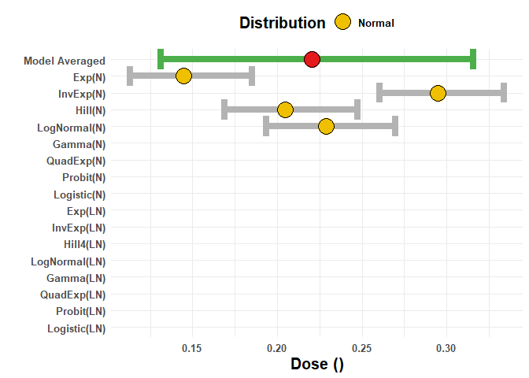
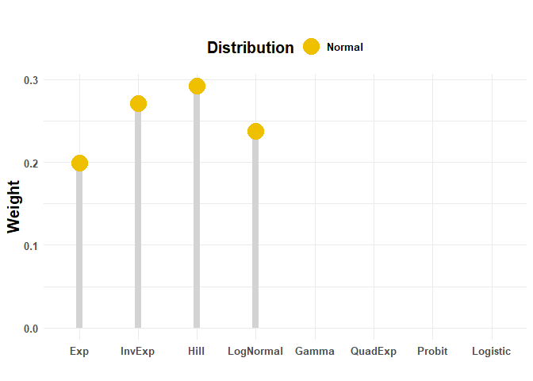
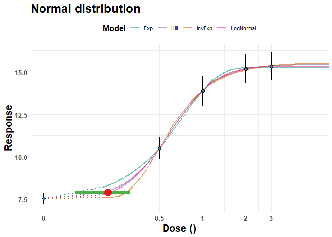
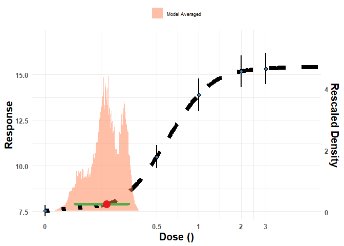

<!-- README.md is generated from README.Rmd. Please edit that file -->

# BMABMDR

<!-- badges: start -->

<!-- badges: end -->

BMABMDR is an R package for Bayesian model averaging in benchmark dose
estimation. Its two main functions are:

- `full.laplace_MA()` to perform model averaging using Laplace
  approximation

- `sampling_MA()` to perform model averaging using Bridge sampling

## Installation

You can install the latest development version (0.2.1) of the R package
from GitHub:

``` r
# install.packages("remotes")
remotes::install_github("cecilekremer/BMABMDR@testing")
```

This currently works with the combination of **rstan 2.32.7** and
**StanHeaders 2.32.10**. If you have a different StanHeaders version,
you can install the compatible one with:

``` r
remotes::install_version("StanHeaders", version = "2.32.10", type = "source")
```

### Requirements

- A C++17 toolchain:
  [Rtools](https://cran.r-project.org/bin/windows/Rtools/) matching your
  R version on Windows, or a recent GCC/Clang on Linux/macOS.
- Installation compiles all Stan models and can take a long time and
  several GB of RAM.
- Restart R and make sure `rstan`/`BMABMDR` are not loaded before
  installing, otherwise Windows may fail to overwrite locked DLLs.

## Example

This is a basic example which shows you how to use the package:

``` r
library(BMABMDR)

## Set summary data

summ.data <- data.frame(x = c(0,0.5,1,2,3),
                        y = c(7.534954, 10.500018, 13.886423, 15.192057, 15.331456),
                        s = c(0.3131743, 0.6299896, 0.8874875, 0.8709575, 0.8501652),
                        n = c(20, 20, 20, 20, 20))

## Check if there is a dose-response effect

anydoseresponseN(summ.data$x, summ.data$y, summ.data$s, summ.data$n)
#> Loading required package: gamlss
#> Loading required package: splines
#> Loading required package: gamlss.data
#> 
#> Attaching package: 'gamlss.data'
#> The following object is masked from 'package:datasets':
#> 
#>     sleep
#> Loading required package: gamlss.dist
#> Loading required package: nlme
#> Loading required package: parallel
#>  **********   GAMLSS Version 5.5-0  **********
#> For more on GAMLSS look at https://www.gamlss.com/
#> Type gamlssNews() to see new features/changes/bug fixes.
#> $bf
#> Estimated Bayes factor in favor of bridge_SM over bridge_H0: 750498364556829503128828460444260660864404060844828884082000648.00000
#> 
#> $bf.message
#> [1] "Preliminary analysis found insufficient evidence of no dose effect (Bayes factor : 0 in favor of the NULL (no dose effect) model)."
anydoseresponseLN(summ.data$x, summ.data$y, summ.data$s, summ.data$n)
#> $bf
#> Estimated Bayes factor in favor of bridge_SM over bridge_H0: 1162596138617800377222628442884666686602606440604248448006020428.00000
#> 
#> $bf.message
#> [1] "Preliminary analysis found insufficient evidence of no dose effect (Bayes factor : 0 in favor of the NULL (no dose effect) model)."

## Prepare data to pass to main functions

data_N <- PREP_DATA_N(data = summ.data,
                       sumstats = TRUE, sd = TRUE, q = 0.05)
#> GAMLSS-RS iteration 1: Global Deviance = -8.2198 
#> GAMLSS-RS iteration 2: Global Deviance = -8.2198
#> default prior choices used on background
#> default prior choices used on fold change
#> default prior choices used on BMD
#> GAMLSS-RS iteration 1: Global Deviance = 4.4297 
#> GAMLSS-RS iteration 2: Global Deviance = 4.4297
data_LN <- PREP_DATA_LN(data = summ.data,
                       sumstats = TRUE, sd = TRUE, q = 0.05)
#> distributional assumption of constant variance (on log-scale) is met, Bartlett test p-value is 0.4557
#> GAMLSS-RS iteration 1: Global Deviance = -8.2198 
#> GAMLSS-RS iteration 2: Global Deviance = -8.2198
#> default prior choices used on background
#> default prior choices used on fold change
#> default prior choices used on BMD
#> GAMLSS-RS iteration 1: Global Deviance = 4.4297 
#> GAMLSS-RS iteration 2: Global Deviance = 4.4297

## Perform model averaging using Laplace approximation

# We include only Family 1 for the Normal distribution in this example
FLBMD <- full.laplace_MA(data_N, data_LN, prior.weights = c(rep(1, 4), rep(0, 12)))

# Plot results
pFLBMD <- plot.BMADR(FLBMD, type = 'increasing', weight_type = 'LP', title = '')
#> `height` was translated to `width`.
#> `height` was translated to `width`.
#> `height` was translated to `width`.
#> `height` was translated to `width`.
#> `height` was translated to `width`.
pFLBMD$BMDs
#> `height` was translated to `width`.
#> `height` was translated to `width`.
```



``` r
pFLBMD$weights
```



``` r
pFLBMD$model_fit_N
#> `height` was translated to `width`.
```



``` r
pFLBMD$MA_fit
#> `height` was translated to `width`.
```



``` r

## Perform model averaging using Bridge sampling

SBMD <- sampling_MA(data_N, data_LN, prior.weights = c(rep(1, 4), rep(0, 12)))
#> convergence achieved.
#> 
#> convergence achieved.
#> 
#> convergence achieved.
#> 
#> convergence achieved.

# Plot results
pSBMD <- plot.BMADR(SBMD, type = 'increasing', weight_type = 'BS', title = '')
#> `height` was translated to `width`.
#> `height` was translated to `width`.
#> `height` was translated to `width`.
#> `height` was translated to `width`.
#> `height` was translated to `width`.
```

## Getting help

If you encounter a bug, please file an issue with a minimal reproducible
example on [GitHub](https://github.com/cecilekremer/BMABMDR/issues).
